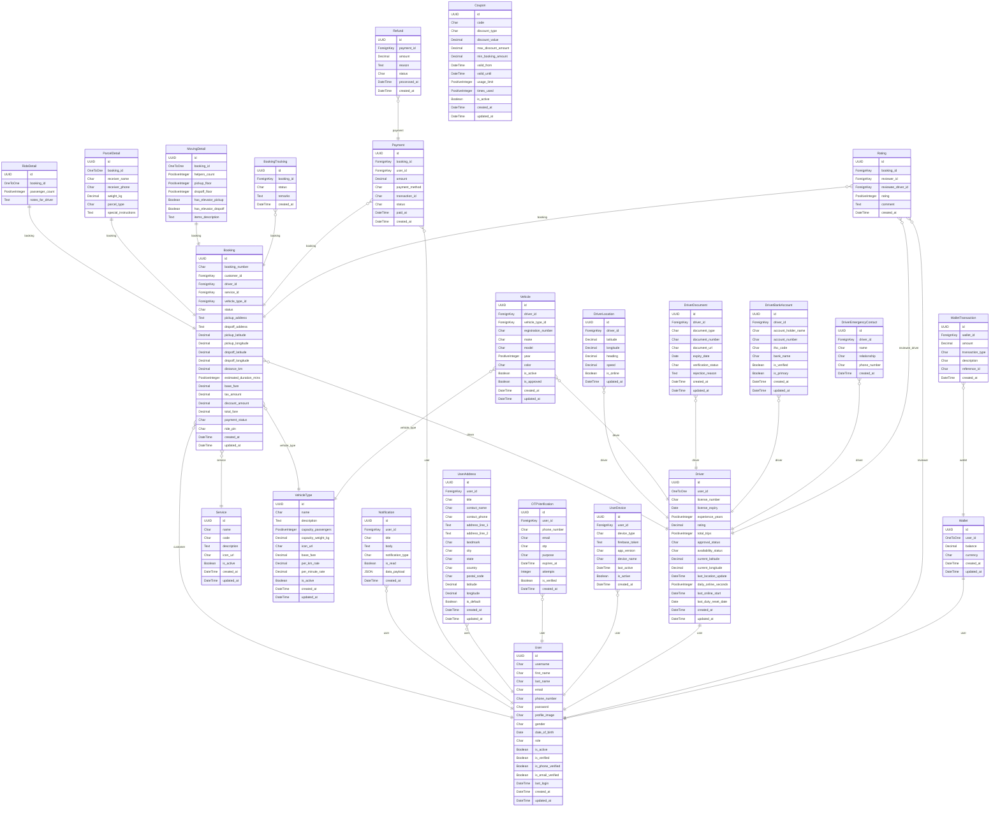

# RaahGo Database ER Diagram

Below is the Entity-Relationship (ER) diagram reflecting the exact data structure of your Django database, including all models across your custom apps (`users`, `bookings`, `drivers`, `payments`, `vehicles`, etc.).

