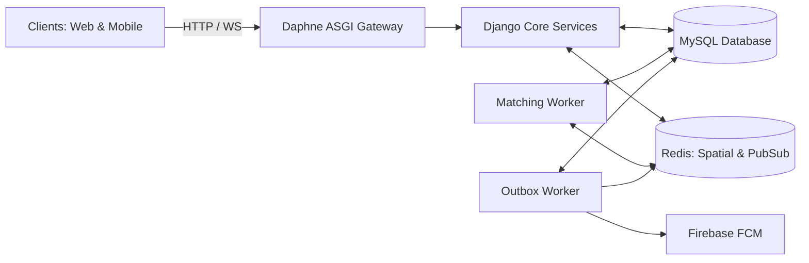

# RaahGo Documentation Hub

Welcome to the technical documentation repository for **RaahGo** — the real-time ride-hailing, courier logistics, and fleet operations platform.

---

## Primary Documentation Index

The complete, master engineering manual is located at:
👉 **[PROJECT_DOCUMENTATION.md](./PROJECT_DOCUMENTATION.md)**

---

## Quick Navigation by Subject

| Topic | Direct Section Link | Summary |
|---|---|---|
| 🚨 **Security Vulnerabilities** | [Section 8: Vulnerability Assessment](./PROJECT_DOCUMENTATION.md#8-comprehensive-security-vulnerability-assessment) | Audit of 10 security findings (OTP leaks, unverified JWT, BOLA/IDOR, mock payments) with code references & remediation roadmap. |
| ⚡ **Core Pipelines** | [Section 6: Core Technical Pipelines](./PROJECT_DOCUMENTATION.md#6-core-technical-pipelines) | In-depth breakdown of Geospatial Redis Telemetry, 4-Stage Matching with Radius Expansion & Locks, and Transactional Outbox Pattern. |
| 🚦 **Traffic & Scalability** | [Section 10: Traffic Management](./PROJECT_DOCUMENTATION.md#10-high-scale-traffic-management--concurrency-blueprint) | Architectural plan for 100k+ concurrent drivers, load balancing, WebSocket stickiness, connection pooling, and Redis geohash clustering. |
| 🔄 **User Processors & Journeys** | [Section 7: System Processors](./PROJECT_DOCUMENTATION.md#7-system-processors--user-journey-lifecycles) | Detailed state machines and flowcharts for Customer (Rider), Driver (Captain), and Admin Operations. |
| 📊 **Completed vs Pending** | [Section 9: Progress Scorecard](./PROJECT_DOCUMENTATION.md#9-project-progress-scorecard-completed-vs-pending) | Granular breakdown of what is 100% completed, in progress, and pending across backend, frontends, and mobile. |
| 🗺️ **Database ERD** | [Section 5: Database Architecture](./PROJECT_DOCUMENTATION.md#5-database-architecture--entity-relationship-model) | Entity-relationship model across users, drivers, vehicles, bookings, wallets, and outbox messages. |
| 🛠️ **Deployment Runbook** | [Section 11: Operations Runbook](./PROJECT_DOCUMENTATION.md#11-operations--deployment-runbook) | Local run commands and systemd production service definitions for ASGI, matching daemons, and outbox processors. |

---

## Architecture at a Glance

*For complete implementation details, code locations, and technical diagrams, refer to [PROJECT_DOCUMENTATION.md](./PROJECT_DOCUMENTATION.md).*
